# IMDb Hollywood Actors Explorer

IMDb Hollywood Actors Explorer is an applied data science project developed in
Python. It demonstrates a complete workflow for collecting, storing, and
exploring information about movies and awards for the 50 actors and actresses
included in the IMDb list used by the project.

> This project is an educational example of web scraping, relational data
> modelling, and parameterised SQL queries. IMDb is a trademark of IMDb.com,
> Inc. The included database is a point-in-time snapshot and is not an official
> IMDb data export.

## What the project does

A Jupyter notebook uses web scraping to collect and organise the data. The
results are stored in a local SQLite database, which is then queried by an
interactive terminal application. Users can select an actor or actress and
explore their biography, filmography, genres, ratings, and awards.

After selecting an actor or actress by ranking or name, the terminal program
offers six views:

1. Biography / “about” information
2. All known movie titles and years
3. Awards for a selected year
4. Distinct movie genres
5. Overall and year-by-year average movie ratings
6. The five highest-rated movies, with year and genre

The program then lets the user choose another actor, return to the options, or
exit.

## Components

The project consists of three components:

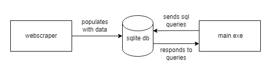

1. **Web Scraper** - [`webscraper.ipynb`](webscraper.ipynb) collects
   information about the actors, their movies, genres, and awards. It populates
   the database and only needs to be run when the dataset is first created or
   refreshed.
2. **SQLite database** - [`database.sqlite`](database.sqlite) persistently
   stores the collected data in a structured format so it can be queried
   locally without scraping IMDb each time.
3. **Terminal application** - [`main.py`](main.py) sends SQL queries to the
   database and formats the selected actor's information for display in the
   terminal.

## Database design

The database is a normalised SQLite schema with five tables:

- `actors` — ranking, name, and biography text
- `movies` — title, rating, and release year
- `awards` — award name, category, year, result, actor, and related movie
- `genres` — the genres associated with each movie
- `actors_play_movies` — the many-to-many actor/movie relationship


The actor/movie relationship is represented by the junction table
`actors_play_movies`. The separate `genres` table represents the
multi-valued genre attribute. Foreign keys connect the related records.

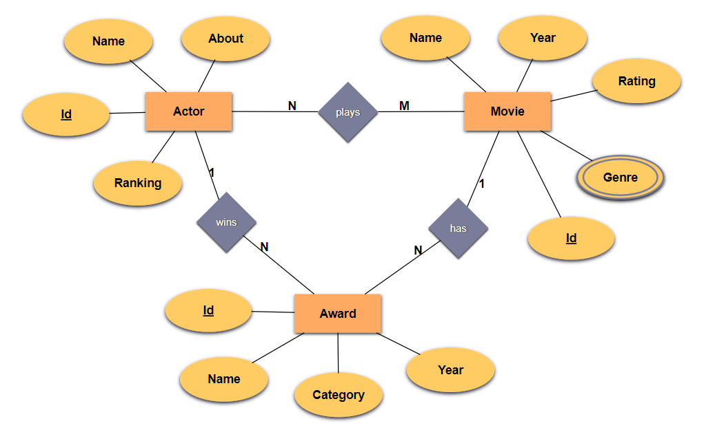

The included snapshot currently contains 50 actors, 3,423 movie credits,
8,143 genre associations, and 7,788 award records. These counts can change if
the notebook is run again because the source website and its list contents may
change.

## Data collection

[`webscraper.ipynb`](webscraper.ipynb) performs the loading process:

1. Opens the IMDb list with Selenium WebDriver.
2. Uses BeautifulSoup to parse actor list items and detail pages.
3. Loads biography, movie, genre, and award information.
4. Clicks “See more” controls where additional filmography or award entries
   are hidden.
5. Builds Pandas dataframes and writes them to `database.sqlite`.

The notebook is intended to be run when the database needs to be rebuilt or
refreshed. The terminal application does not scrape IMDb on every run; it
reads the local database instead.

## Run the terminal explorer

Run this command from the repository root, where `database.sqlite` is located:

```bash
python main.py
```

The application will:

1. Display the ranked actor list.
2. Accept either the displayed ranking or the actor's name.
3. Display the six available queries.
4. Validate numeric menu input.
5. Return to the selected actor or navigation menu after displaying a result.

`main.py` expects the database at `./database.sqlite`. If the program is
started from another directory, either change to the project directory first
or update the database path in the source.

## Control Flow

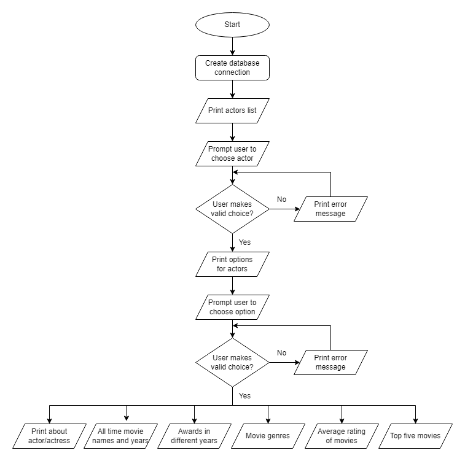

## Example results

The following examples follow the same order as the six actions available in
the terminal application.

### Selecting an actor

The program first displays the ranked list of available actors and actresses.
The user can select an entry using either its number or name.

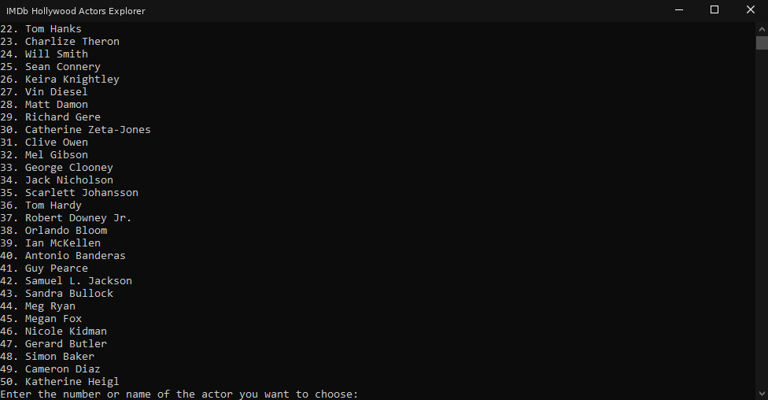

After an actor has been selected, the six available actions are displayed.

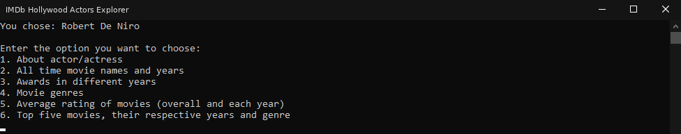

### 1. About an actor or actress

Displays the biography information collected for the selected actor.

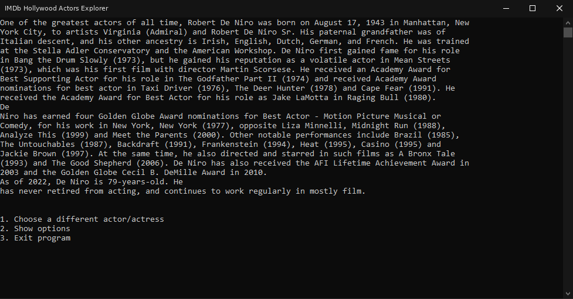

### 2. All-time movie names and years

Lists the movies associated with the selected actor together with their years.

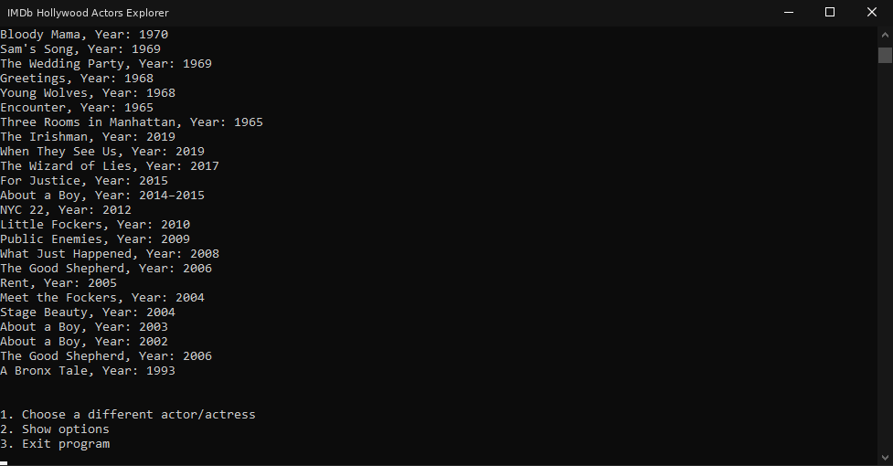

### 3. Awards in a selected year

The program shows the available award period and asks the user to enter a
year before displaying the matching awards.

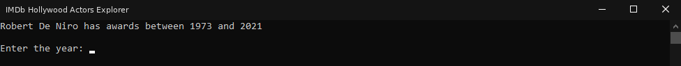

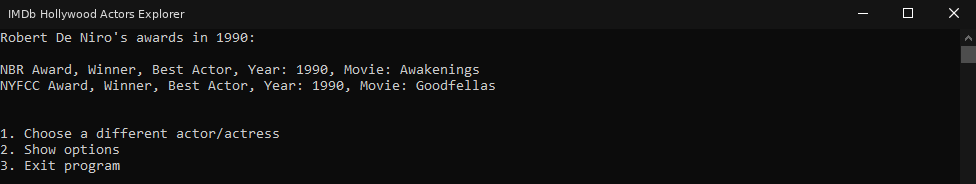

### 4. Movie genres

Displays the distinct genres represented in the selected actor's filmography.

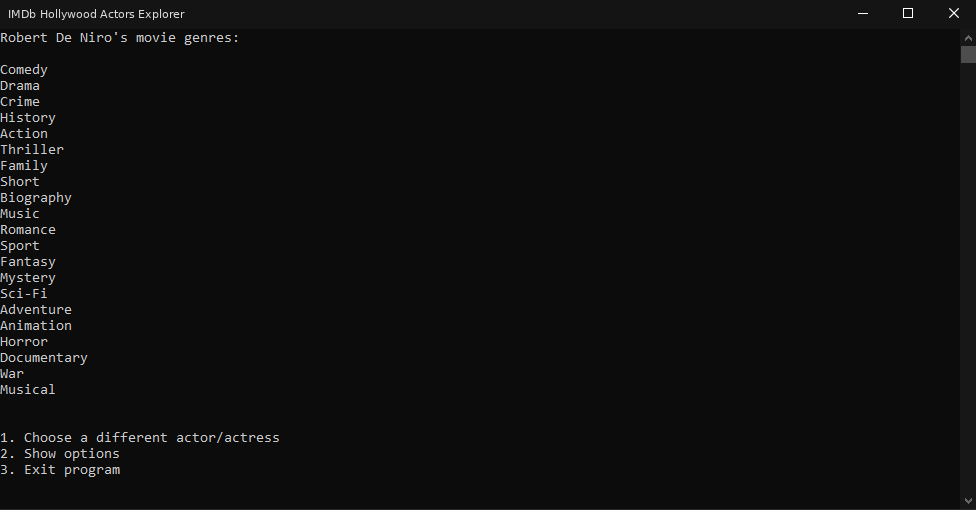

### 5. Average movie ratings

Displays the overall average rating and the average rating grouped by year.

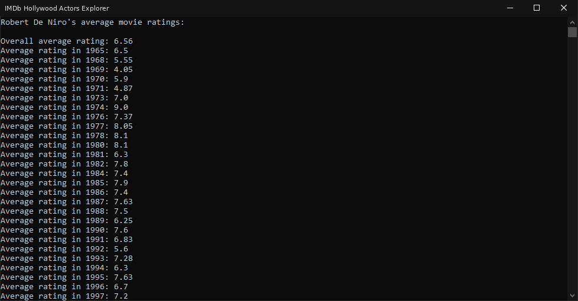

### 6. Top five movies

Displays the five highest-rated movies for the selected actor, together with
their rating, genre, and year.

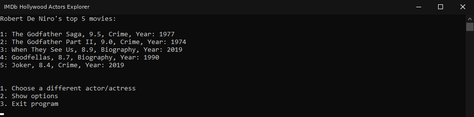

## Project structure

```text
.
├── main.py
├── webscraper.ipynb
├── database.sqlite
└── attachments
    ├── diagrams
    │   ├── components.png
    │   ├── components_light.png
    │   ├── flowchart.png
    │   ├── flowchart_light.png
    │   └── imdb_entity_relationship_model.png
    └── screenshots
```

## Requirements

- Python 3
- Google Chrome (or a compatible Chromium browser)
- A compatible Selenium WebDriver
- Python packages:
  - `beautifulsoup4`
  - `selenium`
  - `pandas`
  - `jupyter` (to run the notebook)

The standard-library modules `sqlite3` and `time` are used as well and do not
need to be installed separately.

## Installation

From the project directory:

```bash
python -m venv .venv
```

Activate the environment:

```bash
# macOS/Linux
source .venv/bin/activate

# Windows PowerShell
.venv\Scripts\Activate.ps1
```

Install the notebook dependencies:

```bash
python -m pip install beautifulsoup4 selenium pandas jupyter
```

The repository already includes [`database.sqlite`](database.sqlite), so the
explorer can be started without scraping first.

## Rebuild or refresh the database

To repeat the data collection process:

```bash
python -m jupyter notebook webscraper.ipynb
```

Run the notebook cells in order. Selenium must be able to start the installed
Chrome/Chromium browser and reach IMDb. The notebook writes its results to the
SQLite database; back up the existing `database.sqlite` first if you want to
preserve the included snapshot. For a clean rebuild, use a fresh database
file: the current notebook replaces the `actors` and `awards` tables but
appends movie, genre, and actor/movie rows.

Because this process visits a third-party website, it may be affected by
network availability, page layout changes, rate limits, consent screens, or
changes to IMDb's “See more” controls. Use it responsibly and in accordance
with the source website's terms.

## Limitations

- The dataset is a snapshot, so ratings, filmographies, awards, and rankings
  may become outdated.
- The scraper depends on IMDb's current HTML structure and interactive page
  controls.
- The application is terminal-based and currently exposes read-only queries.

## Reference

The source list used by the notebook is:

[IMDb list of popular Hollywood actors and actresses](https://www.imdb.com/list/ls053501318/)
